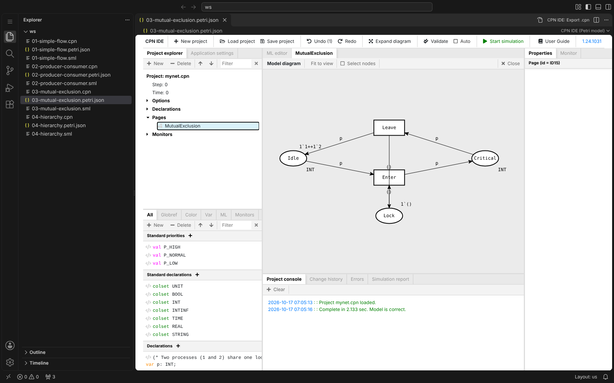
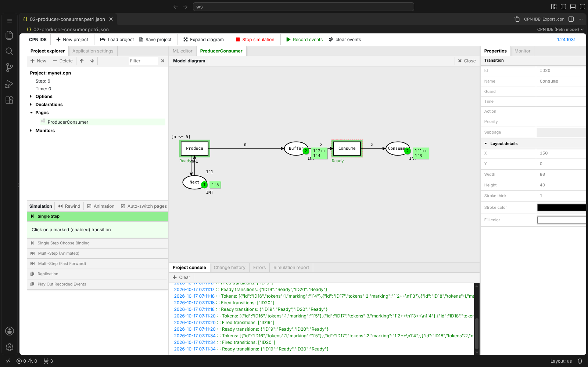
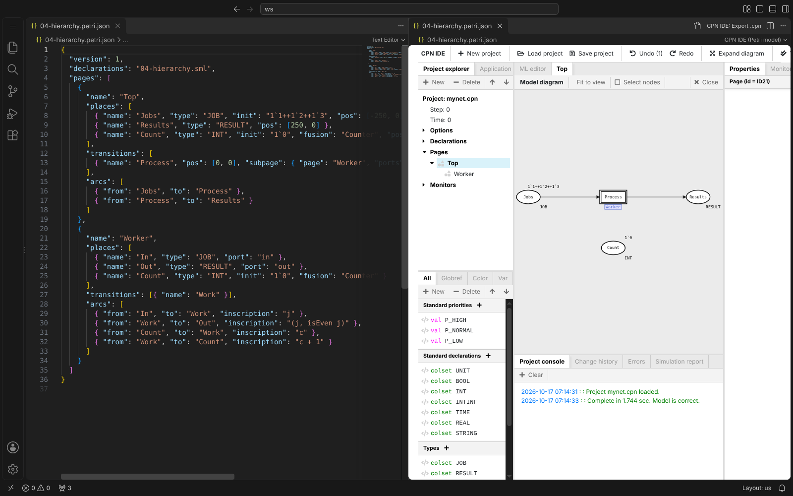
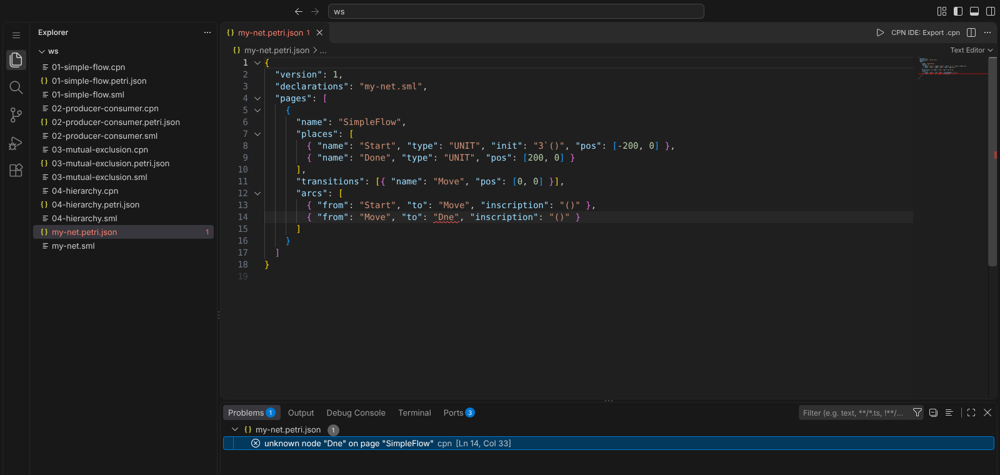

# CPN IDE for VS Code

[](https://github.com/AleFire99/cpn-ide-vscode/actions/workflows/ci.yml)

Draw, validate and simulate **Coloured Petri Nets** without leaving VS Code. The extension runs
[CPN IDE](https://cpnide.org/), the successor of CPN Tools, in an editor tab: open a `.cpn` model, click ▶, and you get
the full CPN IDE canvas, declarations, type checker and simulator. You can also write a net as plain text
(`.petri.json` + `.sml`) and watch it render as a diagram.

Nothing to install first: the CPN IDE backend, UI and simulator ship with the extension, and a Java 17 runtime is
downloaded on first use if you don't already have one.



## Features

- **Edit `.cpn` models** (CPN Tools / CPN IDE format) in a VS Code editor tab. Saving writes back to the workspace file.
- **Validate and simulate**: type-check the model, fire transitions one at a time, or run many steps, with token
  markings shown on the diagram.
- **Text models**: describe places, transitions and arcs in `NAME.petri.json` and the CPN ML declarations in
  `NAME.sml`. Opening the JSON shows the net graphically; edits in the canvas are saved back to the JSON.
- **CPN ML highlighting**: `.sml` declaration files get syntax highlighting, bracket matching and comment toggling.
- **Live diagnostics**: unknown nodes, bad references and type errors show up in the Problems panel as you edit.
- **Convert both ways**: turn an existing `.cpn` into a text model, or export a text model to `.cpn`.
- **Headless runs**: simulate a model for N steps without the UI and print the final marking.
- **Hierarchy**: subpages, substitution transitions with port/socket assignments, and fusion places.

## Getting started

After installing, the **Get Started with CPN IDE** walkthrough opens on the Welcome page (also available via
**Help → Welcome** or **Welcome: Open Walkthrough**). It opens an example, runs a simulation and creates your first
net, step by step.

1. Install **CPN IDE** from the Extensions view (search "CPN IDE").
2. Open a folder that contains a `.cpn` or `.petri.json` file, or run **CPN IDE: Open Example** to copy one of the
   [examples](https://github.com/AleFire99/cpn-ide-vscode/tree/develop/examples) into `cpn-examples/` in your workspace.
3. Open the model:
   - a `.petri.json` opens straight in the CPN IDE canvas;
   - a `.cpn` opens as XML text: click **▶** in the editor title bar (or right-click it in the Explorer →
     **CPN IDE: Open in CPN IDE**).
4. The first time, the extension starts its local backend (and downloads Java if needed). This takes a few seconds; the
   project console at the bottom of the canvas reports **"Model is correct"** once the model has been validated.

To start from scratch, run **CPN IDE: New Net** from the Command Palette (`Ctrl+Shift+P` / `Cmd+Shift+P`), or
right-click a folder in the Explorer. It asks for a name, writes `NAME.petri.json` and `NAME.sml` with a small starter
net, and opens it in the canvas.

## Simulating a model

Click **Start simulation** in the CPN IDE toolbar. Enabled transitions are highlighted in green; click one to fire it,
or use the **Simulation** panel on the left:

| Action | What it does |
|---|---|
| Single Step | Fire the transition you click |
| Single Step Choose Binding | Pick which binding of the variables to fire |
| Multi-Step (Animated) / (Fast Forward) | Fire many steps, with or without the token animation |
| Rewind | Go back to the initial marking |
| Replication | Run the simulation several times and collect statistics |

The current marking of each place is shown next to it (for example `` 1`2++1`4 `` means one token `2` and one token `4`),
and the project console logs every fired transition.



Multi-step runs wait 100 ms between steps by default. Lower `cpnIde.simulation.stepDelayMs`, or turn off
`cpnIde.simulation.animate`, to make them faster.

For a quick check without the UI, right-click a `.cpn` or `.petri.json` file and choose **CPN IDE: Run Simulation (No
UI)**. Enter the number of steps. The **CPN IDE: Simulation** output channel shows how many steps ran, the final
marking of each place (as `Page/Place`) and any transitions still enabled:

```
Simulated 100 step(s) in 1301 ms
Final marking:
  MutualExclusion/Idle      1`1++ 1`2
  MutualExclusion/Lock      1`()
  MutualExclusion/Critical  empty
Still enabled: MutualExclusion/Enter
```

## Text models

A net can be written by hand, versioned and diffed like any other source file. A model has two files next to each
other:

- `NAME.petri.json`: pages, places, transitions and arcs.
- `NAME.sml`: CPN ML declarations (colour sets, variables, functions).

```json
{
  "version": 1,
  "declarations": "mutex.sml",
  "pages": [
    {
      "name": "MutualExclusion",
      "places": [
        { "name": "Idle", "type": "INT", "init": "1`1++1`2" },
        { "name": "Lock", "type": "UNIT", "init": "1`()" },
        { "name": "Critical", "type": "INT" }
      ],
      "transitions": [{ "name": "Enter" }, { "name": "Leave" }],
      "arcs": [
        { "from": "Idle", "to": "Enter", "inscription": "p" },
        { "from": "Lock", "to": "Enter", "inscription": "()" },
        { "from": "Enter", "to": "Critical", "inscription": "p" },
        { "from": "Critical", "to": "Leave", "inscription": "p" },
        { "from": "Leave", "to": "Idle", "inscription": "p" },
        { "from": "Leave", "to": "Lock", "inscription": "()" }
      ]
    }
  ]
}
```

```sml
(* mutex.sml *)
var p: INT;
```

- The standard declarations (`UNIT`, `BOOL`, `INT`, `STRING`, `P_HIGH`, ...) are added automatically. Declare the same
  name to override one.
- Positions (`"pos": [x, y]`) are optional: nodes without one are laid out automatically.
- Transitions can have a `guard`, `time`, `priority` and `code`; places can join a `fusion` set; a transition with a
  `subpage` becomes a substitution transition. The full format is in
  [`schema/petri.schema.json`](https://github.com/AleFire99/cpn-ide-vscode/blob/develop/schema/petri.schema.json), and
  VS Code completes and validates `.petri.json` files against it.
- `(*! Block *)` or `(*! Outer / Inner *)` in the `.sml` starts a named block in the declarations tree.
- Snippets help you type models: in a `.petri.json`, `petri` inserts a whole model skeleton, and `page`, `place`,
  `transition`, `arc` and `subpage` insert one element each (Tab moves between the fields). In a `.sml` file (language
  *CPN ML*), `colset`, `var`, `fun` and `block` insert declarations.

Keep the JSON in one editor and the canvas in another (**CPN IDE: Reopen as XML Text** switches a canvas tab back to
text). The canvas reloads when either file changes on disk.



Compile errors are reported while you type. When the backend is running and no CPN IDE tab is open, saved models are
also type-checked by the simulator.



**CPN IDE: Convert to Text Model** turns an existing `.cpn` into `.petri.json` + `.sml` (graphics and monitors are
dropped, with a warning). **CPN IDE: Export .cpn** writes the compiled model of a `.petri.json` as a `.cpn` file you can
open in CPN Tools or CPN IDE.

## Commands

| Command | Where | What it does |
|---|---|---|
| CPN IDE: Open Example | Command Palette, walkthrough | Copy a bundled example into `cpn-examples/` and open it |
| CPN IDE: Open in CPN IDE | ▶ in the editor title, Explorer menu | Open a `.cpn` / `.petri.json` in the CPN IDE canvas |
| CPN IDE: Reopen as XML Text | editor title | Show the file as text again |
| CPN IDE: New Net | Command Palette, Explorer folder menu | Create `NAME.petri.json` + `NAME.sml` with a starter net and open it |
| CPN IDE: Open Blank Panel | Command Palette | Open CPN IDE in a panel that is not tied to a file |
| CPN IDE: Convert to Text Model | `.cpn` editor title, Explorer menu | Write `.petri.json` + `.sml` from a `.cpn` |
| CPN IDE: Export .cpn | `.petri.json` editor title, Explorer menu | Write a `.cpn` from a text model |
| CPN IDE: Run Simulation (No UI) | Explorer menu | Simulate N steps and print the final marking |
| CPN IDE: Show Backend Log | Command Palette | Open the backend and simulator log |
| CPN IDE: Stop Backend | Command Palette | Stop the backend and simulator |
| CPN IDE: Restart Backend | Command Palette, status bar | Restart the backend and reload open CPN IDE tabs |

## Settings

| Setting | Default | Description |
|---|---|---|
| `cpnIde.simulation.stepDelayMs` | `100` | Delay between steps of a multi-step run, in ms (CPN IDE itself uses 500) |
| `cpnIde.simulation.animate` | `true` | Animate tokens moving during simulation |
| `cpnIde.javaPath` | | Java 17+ executable. Empty: use `JAVA_HOME`, `java` on the PATH, or a downloaded runtime |
| `cpnIde.backendUrl` | | URL of an external backend, e.g. the Docker image below. Empty: use the bundled one |
| `cpnIde.port` | `0` | Port of the local backend (`0` = any free port) |
| `cpnIde.debug` | `false` | Keep the UI's verbose console output in the webview developer tools |

Simulation and debug settings apply when a CPN IDE tab is (re)opened.

## Platform support

| Platform | Local simulator | Notes |
|---|---|---|
| Windows x64 | yes | |
| Linux x64 | yes | needs 32-bit glibc: `sudo apt install libc6:i386` (Debian/Ubuntu) or `sudo dnf install glibc.i686` (Fedora) |
| macOS | no | the CPN simulator is a 32-bit binary; run the [Docker backend](#docker-backend) and set `cpnIde.backendUrl` |

## Troubleshooting

The **CPN IDE** item in the status bar shows the backend state: ○ not running, spinning while it
starts, ✓ ready, red when the backend or the simulator failed. Click it to show the log, restart or stop the backend.

- **"The simulator could not start"**: on Linux, install the 32-bit glibc above. Otherwise click **Show Log** (or run
  **CPN IDE: Show Backend Log**) to see why.
- **A simulator is already running on port 20001**: the CPN simulator always uses this port, so only one can run per
  machine. A second VS Code window shares the first one's simulator. If a crashed window left one behind, the extension
  offers to stop it.
- **Validation never finishes**: after 60 s the extension reports the hang. Run **CPN IDE: Stop Backend** and reopen the
  model.
- **Java download blocked** (offline or behind a proxy): install a Java 17+ runtime yourself and set `cpnIde.javaPath`.

## Examples

The [`examples/`](https://github.com/AleFire99/cpn-ide-vscode/tree/develop/examples) folder has four small models, each
as a text model and as a generated `.cpn`:

| Model | What it shows |
|---|---|
| `01-simple-flow` | Three `UNIT` tokens move from *Start* to *Done*; the net stops after 3 steps |
| `02-producer-consumer` | A counter produces items 1..5 into a buffer (guard `[n <= 5]`) and a consumer takes them out |
| `03-mutual-exclusion` | Two processes share one lock, so at most one is ever in *Critical* |
| `04-hierarchy` | A *Worker* subpage behind a substitution transition, with a fusion place shared by both pages |

## How it works

The extension bundles CPN IDE 1.24.1031 (Java backend and Angular UI) and runs the UI in a VS Code webview. The backend
listens on `127.0.0.1` only. It drives the CPN simulator daemon (`cpnmld`, fixed port 20001), which compiles and runs
the model's SML code. The extension patches the daemon to listen on `127.0.0.1` only, runs it in a private per-user temp
directory, and stops it, with its workers, when the backend stops or VS Code exits. Daemons left by a crashed VS Code
are cleaned up on the next start. Requests that create a net go through a small local proxy that runs them one at a
time, because two at once can hang the upstream backend.

## Docker backend

On macOS, or to keep the simulator off your machine:

```sh
docker run -p 8080:8080 ghcr.io/alefire99/cpn-ide-backend:latest
```

Then set `cpnIde.backendUrl` to `http://localhost:8080`.

## Contributing

Bug reports and ideas are welcome in the [issue tracker](https://github.com/AleFire99/cpn-ide-vscode/issues). See
[CONTRIBUTING.md](CONTRIBUTING.md) for the development setup. We use Git Flow: work on `feature/*` branches, open PRs
into `develop`.

## License

AGPL-3.0, same as upstream [CPN IDE](https://github.com/cpn-io/cpn-js). See
[THIRD_PARTY_NOTICES.md](THIRD_PARTY_NOTICES.md).
